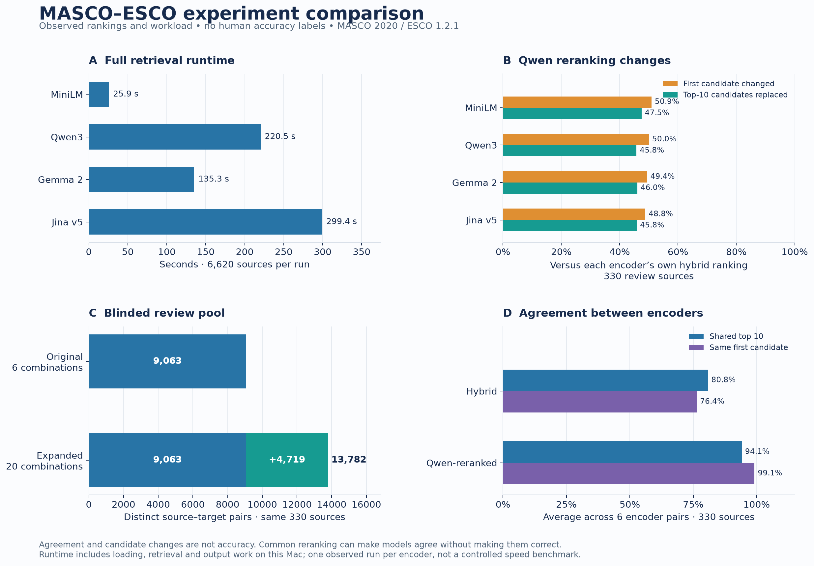

# MASCO–ESCO Crosswalk Research

linking MASCO 2020 occupations to ESCO v1.2.1 using lexical retrieval, embeddings, hybrid ranking and independent human validation.

**Status: candidate-generation experiments, not a validated crosswalk.** There are currently no independent human reference labels and no accepted mappings. Agreement between models is not accuracy.

## Current snapshot

| Measure | Result |
|---|---:|
| Extracted MASCO occupation codes | 6,620 |
| Unique ESCO occupation URIs | 3,039 |
| Encoders in the controlled comparison | 4 |
| Occupations in the fixed review sample | 330 |
| Method/input combinations in the review pool | 20 |
| Blinded candidate pairs | 13,782 |
| Independently validated mappings | 0 |

The MASCO publication contains conflicting totals; 6,620 refers to the extracted visible systematic index, not an officially certified total. All ten major groups are represented. Full-inventory retrieval has been executed; Qwen3 reranking covers the fixed 330-occupation review sample.



## Repository structure

```text
studies/masco2020-esco121/
  scripts/       acquisition, extraction, retrieval, reranking and review tools
  configs/       fixed experimental and pooling configurations
  schemas/       record contracts and human acceptance rules
  docs/          annotation, evaluation, source-quality and methods notes
  sources/       source provenance and model revision manifests (no source files)
experiments/
  2026-10-26-v1-baselines/   initial six baseline/input combinations
  2026-10-26-v2-hybrid/     controlled encoders, reranking and aggregate figures
  TEMPLATE/                starting point for a new immutable experiment
  index.json               experiment registry
requirements/              lightweight tests, extraction and optional inference
scripts/                   repository maintenance and verification
tests/                    synthetic contract tests requiring no private data
```

Each experiment records its configuration, provenance, dependencies, metrics and limitations. Existing experiment snapshots are retained; subsequent work receives a new ID. See [iteration protocol](docs/iterations.md).

## Start here

- [Latest experiment and interpretation](experiments/2026-10-26-v2-hybrid/README.md)
- [All 20 method/input combinations](experiments/2026-10-26-v2-hybrid/figures/02_all_methods.png)
- [Encoder agreement](experiments/2026-10-26-v2-hybrid/figures/03_encoder_agreement.png)
- [Review-pool growth](experiments/2026-10-26-v2-hybrid/figures/04_pool_by_group.png)
- [Study setup and reproduction](studies/masco2020-esco121/README.md)
- [Validation status](docs/validation.md) and [data policy](docs/data-policy.md)

## Run the lightweight checks

Python 3.14 is used for the portable test environment. No source publications, full occupation records, GPUs or model weights are needed for these tests.

```bash
python -m venv .venv
.venv/bin/python -m pip install -r requirements/test.txt
.venv/bin/python -m unittest discover -s tests -v
.venv/bin/python scripts/verify_snapshot.py
```

Full research reproduction requires separately obtained source files and model weights. The study guide documents their versions, hashes, local storage and commands. The original local research archive is deliberately excluded from Git.

## Attribution and reuse

Maintained by Charles Yi. See [CITATION.cff](CITATION.cff), [third-party sources](docs/sources.md) and [LICENSE](LICENSE). Classification publishers and model providers retain their own rights. This project has no official classification-owner endorsement.
